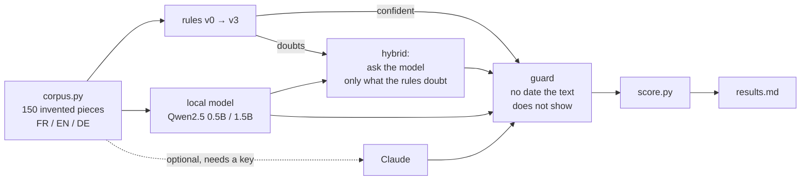

# rules-vs-llm-filing-bench

**When do you actually need a language model?** A benchmark on one narrow, very common
task: an accounting firm receives documents from its clients (invoices, bank statements,
payslips, tax notices, contracts...) and must give each one a file name and a folder.

The firm's convention is `YYYY-MM Nature [Emitter]` in French, whatever the language of
the document, e.g. `2025-03 Relevé bancaire Banque Atlas` in `2025/Banque`. If the date
cannot be read, the name must say so: `SANS-DATE Note de frais` ("no date").

Inspired by a system I built for an accounting firm in Luxembourg, where the filing
assistant was deliberately built **without** AI. This repository rebuilds that path from
scratch on invented data, measures it, and puts it next to small open language models.

## What is in the box



1. **A deterministic corpus** ([`filing_bench/corpus.py`](filing_bench/corpus.py)): 150 pieces of
   extracted text with messy original file names (`IMG_20250601_101010.jpg`, `scan_0042.pdf`,
   `Copie de copie de scan3.pdf`), in French, English and German, each with the expected name
   and folder. The traps are the real ones: due dates and print dates next to the issue date,
   a statement number that looks like a month (`3/2025`), birth dates on payslips, quarters
   (`2. Quartal 2024`), two-digit years on receipts, a photo date in the file name, a bank
   statement that says "invoice" and "salary" in its lines, a letterhead lost as an image so the
   emitter only survives in the footer, OCR damage, pieces with no date at all.
   - **dev** (99 pieces): the rules were written while looking at these.
   - **test** (51 pieces): other emitters, and for every list of phrasings one wording that
     never appears in dev (`Anstellungsvertrag`, `Facture d'avoir`, `Closing date`...). A test
     checks that this wording never leaks into dev.
2. **A rules engine in four versions** ([`filing_bench/rules.py`](filing_bench/rules.py)), each a
   subclass of the previous one adding one idea: v1 dates, v2 multilingual vocabulary and a
   period policy per nature, v3 the parties (emitter, customer, credit-note sign, letter sender).
3. **Language models** ([`filing_bench/llm.py`](filing_bench/llm.py)): Qwen2.5-0.5B-Instruct and
   Qwen2.5-1.5B-Instruct run locally with `transformers` (pinned revisions, greedy decoding, no
   key), same prompt, same closed lists. Claude is optional and only runs with
   `ANTHROPIC_API_KEY`. Every answer is cached in `results/cache/` as evidence.
4. **A hybrid**: rules first; the model is asked only when the rules report low confidence,
   only about what they doubt. Its threshold is chosen on dev, then applied once to test.
5. **A guard** ([`filing_bench/guard.py`](filing_bench/guard.py)) between every proposer and the
   file name: a period only passes if the document text shows it. Otherwise the name says
   `SANS-DATE` and the piece goes to "À classer" instead of a year folder it would have
   invented. The file name is never evidence. The guard is tested **by mutation**.

## Results

All numbers below are copied from [`results.md`](results.md), which `filing_bench/bench.py`
generates (measured on 10 November 2026, local models on a GTX 1650 4 GB, float16, greedy decoding).
"ok" means the file name **and** the folder are exactly right, so the line could be accepted
without touching it.

**The road of the rules** (test split = 51 pieces never used to write the rules):

| version | idea added | ok (dev) | ok (test) |
|---|---|---|---|
| v0 | naive: first `dd/mm/yyyy`, French keywords, no emitter | 1 % | 0 % |
| v1 | every date format FR/EN/DE, weighed by the words before it; no date -> `SANS-DATE` | 23 % | 20 % |
| v2 | multilingual vocabulary weighed by zone, period policy per nature | 48 % | 41 % |
| v3 | the parties: emitter (footer fallback), customer, credit-note sign, letter sender | 100 % | 88 % |

v0 put **81** invented dates into names (photo dates from the file name, "today" as a
fallback); the guard blocked all of them. From v1 on, the rules never invent one (a test
checks it on all 150 pieces).

**Rules versus local models** (same pieces, same convention, same guard):

| approach | ok (dev) | ok (test) | dates invented, blocked by the guard | time per piece |
|---|---|---|---|---|
| rules v3 | 100 % | 88 % | 0 | about 1 ms on CPU |
| Qwen2.5-0.5B-Instruct | 8 % | 4 % | 21 | 4.6 s on GPU |
| Qwen2.5-1.5B-Instruct | 22 % | 24 % | 18 | 10.9 s on GPU |
| hybrid v3 + 1.5B (threshold chosen on dev) | 100 % | 88 % | 0 | about 1-2 ms (model never called) |

**What the model brings here: nothing measurable.**

- The rules are thousands of times faster than the 1.5B model (milliseconds against seconds; exact figures vary with machine load and are in `results.md`) and right on 88 % of unseen
  pieces against 24 %.
- The small models get the period right fairly often (67-75 % on test) but not the rest. They
  answer natures that are not on the list ("Bank statement" for "Relevé bancaire"), confuse
  "invoice received" with "invoice issued", keep legal forms in names, pick the wrong folder,
  and take the month after the period (the issue date of a contributions statement instead
  of the month it covers). They also invented 18 to 21 dates, which the guard turned into
  `SANS-DATE`.
- The hybrid could not learn when to ask: on dev the rules are already at 100 %, so every
  threshold ties and the cheapest one wins (never ask). For information only, the test
  columns of the sweep show the best possible gain would have been **one piece** (88 % -> 90 %,
  1.5B model, 10 % of pieces sent). That is within noise.
- The 6 pieces the rules miss on test are all **wording they never saw**
  (`Anstellungsvertrag`, `Confirmation of cover`, `Record of the shareholders' meeting`,
  `Bescheid über die Körperschaftsteuer`) or a letter about rent that the word "loyer" pulls
  towards "lease contract". That is where a stronger model should help, and it is exactly the
  set the hybrid would send it. Claude was not measured (no key during development): adding
  `ANTHROPIC_API_KEY` adds its row and its cost per 1,000 pieces to `results.md`.

**The guard** is checked by mutation ([`results/mutation.md`](results/mutation.md)): three
deliberate breakages of `guard.py` (accept every date; keep the year folder of a blocked date;
accept a month when only its year is shown) each turn `tests/test_guard.py` red (8, 3 and 1
failing tests); the file is then restored from a backup copy, checked byte for byte, and the
tests are green again.

**So, when is the model unnecessary?** When the documents are of known kinds, the convention is
fixed and the hard part is picking the right date among several: a few hundred lines of
measured rules beat a small local model by a wide margin, cost nothing, answer in a
millisecond and never invent. A model earns its place on the long tail of wording nobody wrote
a rule for, behind rules that know when they doubt and a guard that does not trust it with
dates.

## Run it

```bash
uv venv --python 3.12 .venv && source .venv/bin/activate
uv pip install -r requirements.txt                 # rules only: standard library + pytest
./run.sh --no-llm                                  # corpus, tests, mutation check, rules only (seconds;
                                                   # rewrites results.md without the model rows)

uv pip install -r requirements-llm.txt             # torch + transformers (CUDA 12.8 build; CPU works, see file)
./run.sh                                           # adds Qwen2.5 0.5B and 1.5B and the hybrid
ANTHROPIC_API_KEY=... ./run.sh                     # adds Claude (CLAUDE_MODEL to pick the model)
```

`results/cache/` is committed, so `./run.sh` re-scores the model answers without a GPU or a
download; delete it to regenerate them. `results.md`, `results/mutation.md` and
`results/predictions.jsonl` are written by the scripts, never by hand.

## Layout

```
filing_bench/
  schema.py    the convention: natures, folder tree, compose_name()
  corpus.py    the invented pieces and their expected answers (data/*.jsonl)
  dates.py     date reading for the rules (positions + preceding words)
  rules.py     V0 → V3
  guard.py     no invented date, ever
  llm.py       local model + optional Claude, prompt, parsing, answer cache
  score.py     what "right" means
  bench.py     runs everything, writes results.md
scripts/mutation_check.py   breaks the guard three ways, expects red, restores from backup
tests/                      corpus, rules, guard, model-answer parsing
```

## Limits, honestly

- **The corpus is invented, and the same person wrote it and the rules.** The dev split
  reaching 100 % proves nothing but memory; only the test split, with emitters and wording the
  rules never saw, says something, and even it is easier than real mail: real scans are longer,
  messier, multi-page, and come in layouts nobody planned. On a real document flow, expect the
  rules to score lower and to need tuning on real pieces before anyone trusts them.
- **150 pieces is small.** One piece is 2 points on the test split. Differences of a few points
  between approaches are noise; differences of tens of points are not.
- **The models are small on purpose** (0.5B and 1.5B parameters, what runs on a 4 GB laptop
  GPU). A larger model, or Claude, would read the documents better; the point of the hybrid is
  to pay for that reading only where the rules doubt. The Claude path is written but was not
  run for these results (no key during development): its row appears only when you run it.
- **The prompt was written once and not tuned** against the corpus, unlike the rules, which
  were tuned on dev. That favours the rules on dev, not on test.
- **Text is given, not read.** The benchmark starts from extracted text; OCR quality is
  simulated by letter swaps, not measured.
- Folders are a fixed tree; creating a new folder is out of scope here.

## License

MIT, see [LICENSE](LICENSE). Third-party models keep their own licenses.
